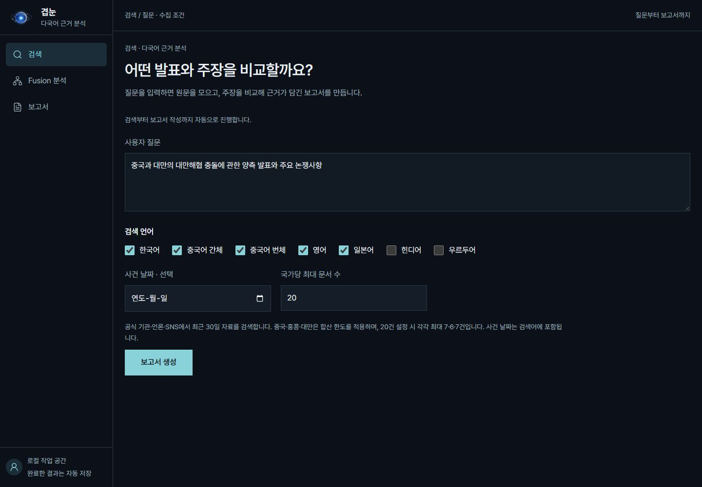
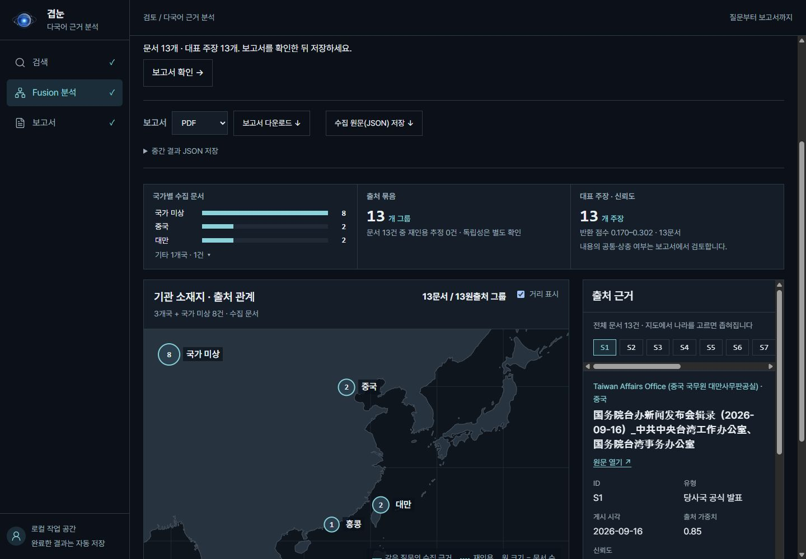
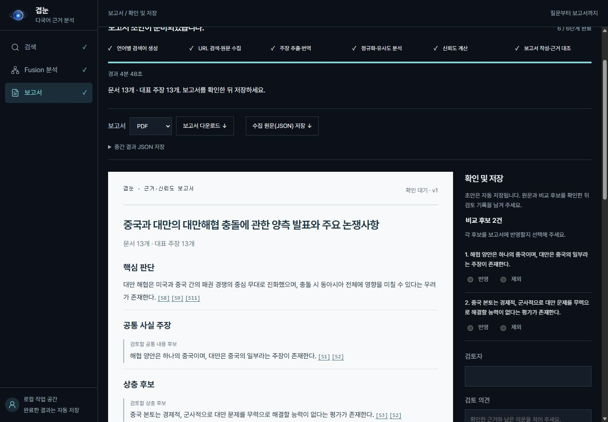

# 겹눈 — 멀티소스 OSINT 인텔 코파일럿

> `겹눈`은 **2026년 10월 10~11일 [KOREAN DEFENSE TECH HACKTHON | D4D x EDTH](https://d4d.tech/events/262177b7-acc1-440b-9618-850b08782e27)** 에 참가해 개발한 4인 팀 프로젝트입니다.  
> `T2 — OSINT & Open-Source Intelligence for APAC`의 `T2-1: 멀티소스 OSINT 인텔 코파일럿(Fusion OSINT Copilot)` 과제로, 여러 언어에 흩어진 공개정보를 출처와 신뢰도가 명시된 판단 자료로 정리하는 문제에 집중했습니다.  
> 개발·시연 일정은 [주최 측 행사 안내](https://luma.com/d4d_edth?locale=ko)에서 확인할 수 있습니다.

`겹눈`은 자연어 질문을 받아 여러 언어의 공개 자료를 수집·분석하고 출처와 신뢰도를 담은 인텔 브리프를 만드는 멀티소스 OSINT 코파일럿입니다. 여러 나라의 발표와 보도가 얽힌 APAC 안보 이슈에서 자료를 찾고 대조하는 시간을 줄이고자 개발했습니다.

이름에는 여러 출처의 정보와 시선을 **겹쳐 보며** 같은 사건의 공통점과 차이를 살핀다는 의미를 담았습니다.

### 기술 스택


### 분석 흐름

> 질문·언어 선택 → 검색어 생성 → 자료 수집 → 주장 추출·번역 → 문서 간 유사도 분석 → 신뢰도 계산 → 보고서 작성

한국어·중국어·일본어·영어·힌디어·우르두어를 지원하며 주장마다 원문 인용과 출처 링크를 연결합니다.

### 근거와 신뢰도

- 신뢰도 계산에는 기관·언론·SNS 등 출처별 가중치와 국가별 보정을 적용했습니다.
- 같은 국가의 문서들이 비슷한 내용을 반복할수록 개별 문서의 기여도를 낮춰 한쪽의 반복 보도가 점수에 과도하게 반영되는 영향을 줄입니다.
- 점수는 근거 검토를 위한 참고 지표이며 공통점과 상충 후보는 사용자가 원문을 확인한 뒤 보고서에 반영합니다.

### 결과와 범위

출처와 문서 관계를 시각화하고 보고서를 PDF·Markdown·JSON으로 제공합니다. 현재는 공개 텍스트 중심의 로컬 단일 사용자 MVP로 분석가가 자료 정리보다 근거 검토와 판단에 집중할 수 있도록 돕는 것이 목표입니다.

[전체 시연 과정 보기](docs/captures/README.md) · [배포·실측 기록](#시연배포-기록) · [빠른 실행](#빠른-실행)

---

## 팀 소개

4인 팀의 역할을 **현재 main의 커밋 이력과 팀에서 확인한 모듈 기여**를 바탕으로 정리했습니다. 기획·도메인 검토처럼 Git에 남지 않는 활동도 있으므로 커밋 수로 기여도를 비교하지 않습니다.

| 팀원                                                  | 확인된 기여                                                                                                                                                | 대표 변경                                                                                                                                                                                                              |
| ----------------------------------------------------- | ---------------------------------------------------------------------------------------------------------------------------------------------------------- | ---------------------------------------------------------------------------------------------------------------------------------------------------------------------------------------------------------------------- |
| [Ina-dang](https://github.com/Ina-dang)               | Ollama 로컬 LLM·분석 파이프라인 연동, FastAPI·화면 통합, 보고서·PDF·검토 흐름, Azure VM 배포·팀 공유 접근 제어·실측 검증                                   | [Ollama·수집 API 연동](https://github.com/Ina-dang/d4d/commit/0761b9d) · [Azure 배포·접근 제어](https://github.com/Ina-dang/d4d/commit/124ed24) · [PDF 다운로드](https://github.com/Ina-dang/d4d/commit/701a315)       |
| [gigachaan](https://github.com/gigachaan)             | OSINT 화이트리스트 선정 기준·출처 티어·가중치 설계, Tavily 다국어 검색·공개 원문 수집, 본문 정제·발췌·수집 스키마                                          | [Tavily 수집 모듈](https://github.com/Ina-dang/d4d/commit/bfdb0fa) · [출처 티어·검색 랭킹](https://github.com/Ina-dang/d4d/commit/677d03f) · [발췌·스키마 개편](https://github.com/Ina-dang/d4d/commit/a80efb1)        |
| [smartwolly5-afk](https://github.com/smartwolly5-afk) | 문서 유사도·국가 보정·출처 가중치 기반 신뢰도 함수, Fusion 국가별 지도·출처 관계 시각화, 별도 Wikipedia 조회수·관련 기사 자료 수집과 관심도 피크 날짜 분석 | [신뢰도 계산](https://github.com/Ina-dang/d4d/commit/30da49c) · [Fusion 지도·화면 개편](https://github.com/Ina-dang/d4d/commit/d397a65) · [Wikipedia 관심도 맥락](https://github.com/Ina-dang/d4d/commit/b12bee4)      |
| [KDSeul](https://github.com/KDSeul)                   | 인텔 분석 결과의 최종 결론 분류 체계 설계·구현, 신뢰도 점수 해석과 사용자용 결과 라벨 표준화                                                               | [연계 기반: 최초 신뢰도 구현](https://github.com/Ina-dang/d4d/commit/30da49c2004ad649b0d4de22b47a5ae17117417a) · [주장별 신뢰도 연결](https://github.com/Ina-dang/d4d/commit/9ece6d07b9e51f833d62a15cb120bbfd68594e9a) |

제공된 모듈 설명과 현재 실행 경로의 라벨은 구분합니다. 현재 기본 신뢰도 함수는 ‘값 일치’·‘개연성 있음’·‘판단 보류’를 반환하며, 이번 문서 수정으로 실행 코드나 라벨 계약을 변경하지는 않았습니다. Wikipedia 관심도 피크는 별도의 맥락 자료이며 신뢰도 점수에는 반영하지 않습니다.

---

## 화면 샘플

저장소에 보존된 2026-10-11 시연 캡처입니다. 화면 속 문서 수·점수·소요 시간은 해당 실행의 예시이며 정확성이나 처리 속도를 보장하지 않습니다.

**[로그인부터 보고서·검토까지 전체 과정 보기](docs/captures/README.md)** · [PC 원본 모음](docs/captures/one-stop-20261011-v2/pc) · [모바일 원본 모음](docs/captures/one-stop-20261011-v2/mobile)

전체 갤러리에서 `로그인 → 질문 → 검색·수집 → Fusion 분석 → 보고서 → 다운로드 → 검토·저장` 순서로 볼 수 있습니다.  
단계별 진행·대기 화면과 모바일 화면도 함께 연결했습니다.

실제 생성된 PDF 샘플도 확인할 수 있습니다: [라벨 포함 보고서](docs/samples/taiwan-labels-report.pdf) · [원스톱 보고서](docs/samples/taiwan-one-stop-report.pdf). 두 파일은 사용자 검토를 마치지 않은 자동 생성 초안이며, 내용의 사실 정확성을 보증하는 자료는 아닙니다. 미리보기가 열리지 않으면 파일을 다운로드해 PDF 뷰어로 확인해주세요.

<details>
<summary>★질문과 수집 조건★</summary>

질문, 언어, 사건 날짜와 문서 상한을 설정합니다. 입력 조건을 정한 뒤 언어별 검색어 생성과 공개 자료 수집으로 이어집니다.



</details>

<details>
<summary>★Fusion 분석과 근거 확인★</summary>

국가별 문서 분포와 출처 관계를 보고 원문 패널에서 근거를 확인합니다. 지도는 출처의 소재 지역을 보여주며 사건 위치나 이동 경로를 추적하지 않습니다. 관계 시각화 자체가 주장의 진위를 판정하는 것은 아닙니다.



</details>

<details>
<summary>★보고서 작성과 사용자 검토★</summary>

근거 인용이 연결된 보고서 초안을 읽고, 비교 후보의 반영·제외와 검토 의견을 저장합니다. PDF·Markdown·JSON 다운로드와 검토·저장 화면은 [전체 갤러리](docs/captures/README.md#6-결과-다운로드)에서 이어서 볼 수 있습니다. 자동 생성된 초안과 사용자의 최종 판단은 구분합니다.



</details>

---

## 시연·배포 기록

서버 접속 없이도 [전체 화면 갤러리](docs/captures/README.md)에서 `로그인 → 질문 → 자료 수집 → Fusion 분석 → 보고서·다운로드 → 검토·저장` 과정을 확인할 수 있습니다. PC·모바일 화면과 실행 기록을 함께 보존했습니다.

`Azure` 일본 서부 VM에 `FastAPI`와 `Ollama`를 배포했습니다.  
systemd로 앱을 실행하고 Caddy로 HTTPS를 구성했으며, UI·API에 접속 인증을 적용했습니다. 로컬뿐 아니라 서버 환경에서의 분석 재시험과 캐시 재사용 결과도 기록했습니다.

| 확인할 내용                          | 자료                                                            |
| ------------------------------------ | --------------------------------------------------------------- |
| 사용 흐름·결과 화면                  | [로그인부터 보고서·검토까지 전체 과정](docs/captures/README.md) |
| 배포 구성·접근 제어·운영 방법        | [Azure 배포 안내](deploy/azure/README.md)                       |
| 서버 실행 결과·캐시 재사용·품질 한계 | [Azure 재시험 실측 기록](docs/azure-retest-20261011.md)         |

실시간 시연은 [팀 공유 시연 서버](https://gyeopnun-demo-20261011.japanwest.cloudapp.azure.com/storyboard/storyboard.html)를 사용합니다. 비용 관리를 위해 상시 가동을 보장하지 않으므로, 실시간 열람이 필요하면 [저장소 소유자](https://github.com/Ina-dang)에게 일정과 접속 방법을 문의해주세요. 평가·포트폴리오 열람용 계정은 요청 시 별도로 전달하며, 전달받은 ID와 비밀번호는 공개 README·포트폴리오에 게시하지 않아야 합니다.

Azure 환경도 팀 공유 단일 작업 공간이며, 계정별 자료 분리·동시 작업 큐는 지원하지 않습니다. 화면 캡처와 Azure 재시험은 서로 다른 실행 기록이므로 문서 수나 처리 시간을 하나의 성능 결과로 합치지 않습니다.

---

## 기술별 역할

| 역할                    | 기술                                                |
| ----------------------- | --------------------------------------------------- |
| API·작업 실행           | Python 3.12 이상 · FastAPI · Pydantic               |
| 공개 자료 검색·수집     | Tavily · `frame/` 수집·정제 모듈                    |
| 검색어·주장·보고서 생성 | Ollama 로컬 LLM · 기본 설정 `gemma4:e2b`            |
| 문서 간 유사도          | Ollama 임베딩 · `bge-m3`                            |
| 신뢰도 계산             | Python 로컬 함수 `analysis.reliability:run`         |
| 화면                    | HTML · CSS · JavaScript                             |
| 저장·배포               | 단계별 JSON 파일 · 기존 분석 앱 SQLite · 로컬/Azure |

기본 자동 실행은 Ollama와 Tavily를 사용하며 OpenAI 키가 필요하지 않습니다. 기존 OpenAI 분석 경로는 `/app`에 별도로 남아 있고 OpenAI·Tavily 키가 모두 필요합니다. 로컬 LLM 연결 실패 시 유료 OpenAI로 자동 전환하지 않습니다.

사건별 원문 검색은 별도 `/rag` 화면에 BM25 기반 미니 RAG로 구현한 **후속 개발용 보조 프로토타입**입니다. 기본 자동 분석·보고서 흐름에는 연결하지 않았으며, 해당 흐름과의 연동은 후속 개발 과제로 남겨뒀습니다. **BGE-M3는 기본 분석의 문서 유사도 계산에 사용**하며, 미니 RAG에 다국어 임베딩 검색·자동 답변까지 연결된 것은 아닙니다.

---

## 주요 기능

| 기능             | 하는 일                                                                |
| ---------------- | ---------------------------------------------------------------------- |
| 다국어 자료 수집 | 자연어 질문을 언어별 검색어로 바꾸고 Tavily로 공개 URL·본문 수집       |
| 주장 추출·번역   | 관련 발췌문에서 주장을 추출하고 한국어 번역·원문 인용·출처 연결        |
| 문서 관계 분석   | BGE-M3 임베딩 유사도와 출처·국가별 문서 분포 표시                      |
| 신뢰도 계산      | 출처 가중치와 국가 내부 반복 보정으로 근거 검토용 점수 계산            |
| 인텔 브리프      | 근거가 연결된 보고서 초안 작성, 비교 후보의 반영·제외와 검토 의견 저장 |
| 결과 내보내기    | PDF·Markdown·JSON 보고서와 수집 원문·중간 결과 JSON 다운로드           |

한국어·중국어·일본어·영어·힌디어·우르두어를 선택할 수 있으며, 중국어는 간체와 번체를 나눠 검색합니다. 언어 선택을 지원한다는 것이 모든 자료의 수집·번역 품질을 보장한다는 뜻은 아닙니다.

### 질문에서 보고서까지

1. **질문 설정** — 질문·검색 언어·선택적 사건 날짜·국가별 문서 상한을 지정합니다.
2. **검색·수집** — Ollama가 검색어를 만들고 Tavily가 URL과 공개 본문을 수집합니다.
3. **주장 분석** — 발췌문에서 주장·번역·인용을 추출하고 문서 간 임베딩 유사도를 계산합니다.
4. **근거 점수** — 로컬 함수가 출처 가중치·국가별 보정을 적용합니다.
5. **보고서 검토** — LLM이 근거를 연결한 초안을 작성하고, 사용자가 비교 후보와 원문을 확인해 저장·다운로드합니다.

작업은 서버에서 계속 실행됩니다. 화면을 이동하거나 새로고침해도 서버가 켜져 있으면 진행 상태를 다시 확인할 수 있습니다. 실패·중단 뒤에는 완료된 단계를 재사용해 재개합니다.

### 신뢰도 점수를 읽는 방법

[신뢰도 함수](analysis/reliability.py)는 문서 간 유사도를 같은 입장에 대한 참고값으로 변환하고, **출처 가중치 × 국가별 반복 보정**으로 가중 평균합니다. 국가 내부 문서가 비슷할수록 보정된 개별 문서의 가중치는 낮아집니다. 현재 주장에 연결되는 점수는 해당 주장이 속한 문서의 점수입니다.

이는 **진실 확률이나 출처 독립성의 증명은 아닙니다**. 비슷한 글도 서로 반대되는 입장을 담을 수 있고, 같은 발표를 재인용한 여러 사이트가 독립 근거로 보일 수 있습니다. 공통점·상충 후보와 점수 라벨은 원문을 검토하기 위한 표시이지 확정된 사실 판정이 아닙니다.

---

## 빠른 실행

`Python 3.12` 이상과 `Ollama`가 필요합니다. PowerShell에서 저장소 폴더 기준으로 실행합니다.

```powershell
python -m venv .venv
.venv\Scripts\python.exe -m pip install -e ".[dev]"

ollama pull gemma4:e2b
ollama pull bge-m3
```

`.env.example`을 `.env`로 복사하고 `TAVILY_API_KEY`를 입력합니다. Ollama가 `http://127.0.0.1:11434`에서 실행 중인지 확인한 뒤:

```powershell
.venv\Scripts\python.exe -m app.cli.check_deployment --check-services
.venv\Scripts\python.exe -m uvicorn app.main:app --host 127.0.0.1 --port 8766
```

[로컬 화면 열기](http://127.0.0.1:8766)에서 질문과 언어를 선택하고 **보고서 생성**을 누릅니다. 키·모델 없이 화면 흐름만 체험할 수도 있지만 실제 자료 분석에는 Tavily 키와 설치된 Ollama 모델이 필요합니다. 화면 안 로그인은 계정 인증이 아니며, Azure 시연은 별도의 팀 공유 HTTP 기본 인증을 적용합니다.

검증한 의존성 버전을 재현하려면 일반 설치 대신 `pip install -r requirements.lock`, `pip install --no-deps -e .`를 순서대로 실행합니다. 모델 설치는 다운로드와 디스크 공간이 필요합니다. 자세한 설정은 [개발·운영 안내](docs/project-guide.md), 원격 실행은 [Azure 배포 안내](deploy/azure/README.md)를 참고하세요.

---

## 시연 범위와 한계

- **공개 텍스트 중심 MVP** — 대만해협·남중국해·태국–캄보디아 국경 이슈를 후보로 삼았고, 대만해협·인도–파키스탄 실행 기록은 [재시험 문서](docs/azure-retest-20261011.md)에 보존돼 있습니다. 키 없는 항공 통제 데모는 가상 자료입니다.
- **검토가 필요한 분석 결과** — 실제 실행에서 번역 오류·관련도 낮은 근거가 발견됐습니다. 자동 처리 완료를 내용 품질 검증 완료로 소개하지 않습니다.
- **힌디어·우르두어 PDF 표시** — 일부 원문 글꼴 표시 문제가 남아 해당 자료는 Markdown·JSON으로 확인합니다.
- **전체 처리 시간은 환경·입력에 따라 다름** — 캐시 재사용 실측은 검색·수집을 제외한 수치입니다. 새 자료의 전체 분석 시간을 보장하지 않습니다.
- **완전 오프라인이 아님** — LLM·임베딩은 로컬에서 실행하지만 검색 질문·URL은 Tavily로 전송됩니다. 비밀 키·민감한 질문·수집 결과를 Git에 올리지 않습니다.
- **실제 안전·작전 판단용이 아님** — 계정별 권한 분리·완전한 출처 독립성 검증은 없으며, 사람의 근거 검토를 돕는 시연 도구입니다.

---

## 더 읽기

| 문서                                                                   | 내용                                          |
| ---------------------------------------------------------------------- | --------------------------------------------- |
| [개발·운영 상세 안내](docs/project-guide.md)                           | API·저장·재개·캐시·기존 OpenAI 경로·검증 기록 |
| [Python 코드 구조](docs/python-structure.md)                           | 역할별 패키지와 CLI 경로                      |
| [수집 모듈](frame/README.md)                                           | 공개 출처 설정·검색·정제                      |
| [주장·유사도 분석](docs/snippet-analysis.md)                           | 발췌문·원문 보완·검증 입력 범위               |
| [보고서 연동](docs/reliability-report.md)                              | 점수·근거 연결과 보고서 생성                  |
| [사건 근거 미니 RAG](docs/mini-rag.md)                                 | 후속 개발용 보조 프로토타입·연동 계획         |
| [Azure 배포](deploy/azure/README.md) · [배포 범위](docs/deployment.md) | 팀 공유 시연·접근 제어·지원 환경              |
| [기여 가이드](CONTRIBUTING.md)                                         | Git-flow·작은 커밋·코드 읽기                  |
